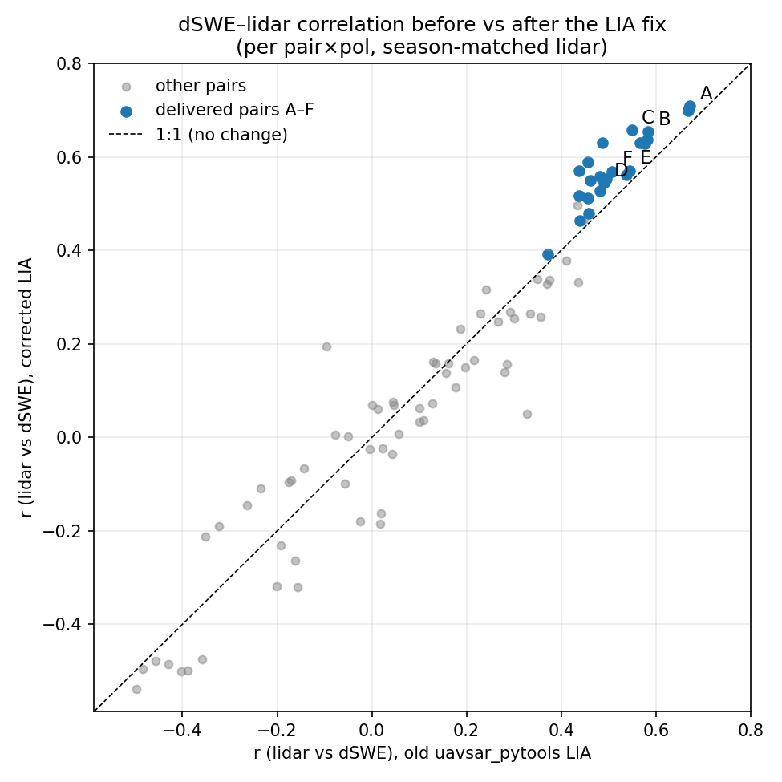

# Impact of the LIA fix on the dSWE vs lidar agreement

The Zarr `lia` was regenerated on 2026-10-30 with the corrected textbook formula
(`lia_corrected.py`), replacing the biased `uavsar_pytools.calc_inc_angle` estimate
(SnowEx/uavsar_pytools#54). The full retrieval chain was rerun: `lia` enters the
atmospheric slant-path mapping (`atm_delay`, `atm_delay_diff`), the Guneriussen-2001
inversion (`1/(cosθ − √(ε−sin²θ))`), and the grazing-angle mask. This report compares
the lidar-depth-change agreement of the retrieved dSWE before and after.
Old values come from the pre-fix snapshot (`dswe_lidar_rank_pre_lia_fix.csv`, archived
alongside this report); new values from the regenerated `dswe_lidar_rank.csv`.

## Per-pair ranking metric (polarization-mean season-matched Pearson r at 90 m)

| pair | letter | line | interval | SNOTEL dSWE (mm) | r old | r new | Δr | rank old → new |
|---|---|---|---|---|---|---|---|---|
| 8 | A | 05208 | 2021-02-10 → 2021-03-03 | +173 | +0.637 | +0.668 | +0.031 | 1 → 1 |
| 2 | B | 23205 | 2021-03-10 → 2021-03-22 | +28 | +0.577 | +0.638 | +0.061 | 2 → 2 |
| 1 | C | 23205 | 2021-03-16 → 2021-03-22 | +28 | +0.483 | +0.612 | +0.129 | 4 → 3 |
| 4 | F | 23205 | 2021-03-10 → 2021-03-16 | +0 | +0.486 | +0.557 | +0.071 | 3 → 4 |
| 5 | D | 23205 | 2021-03-03 → 2021-03-16 | +13 | +0.466 | +0.525 | +0.059 | 5 → 5 |
| 6 | E | 05208 | 2021-03-03 → 2021-03-10 | +13 | +0.454 | +0.476 | +0.023 | 6 → 6 |
| 9 |  | 23205 | 2021-02-10 → 2021-03-03 | +173 | +0.318 | +0.278 | -0.040 | 7 → 7 |
| 18 |  | 23205 | 2020-02-21 → 2020-03-11 | +30 | +0.313 | +0.269 | -0.043 | 8 → 8 |
| 13 |  | 23205 | 2021-01-27 → 2021-02-03 | +43 | +0.255 | +0.254 | -0.002 | 9 → 9 |
| 7 |  | 23205 | 2021-03-03 → 2021-03-10 | +13 | +0.170 | +0.204 | +0.034 | 13 → 10 |
| 21 |  | 23205 | 2019-12-20 → 2020-01-31 | +330 | +0.222 | +0.190 | -0.032 | 10 → 11 |
| 0 |  | 05208 | 2021-03-16 → 2021-03-22 | +28 | +0.185 | +0.174 | -0.011 | 12 → 12 |
| 19 |  | 23205 | 2020-02-13 → 2020-02-21 | +33 | +0.189 | +0.140 | -0.049 | 11 → 13 |
| 15 |  | 23205 | 2021-01-20 → 2021-01-27 | +18 | +0.002 | +0.052 | +0.050 | 16 → 14 |
| 11 |  | 23205 | 2021-02-03 → 2021-02-10 | +15 | +0.109 | +0.052 | -0.058 | 15 → 15 |
| 12 |  | 23205 | 2021-01-27 → 2021-02-10 | +58 | +0.140 | -0.011 | -0.152 | 14 → 16 |
| 10 |  | 05208 | 2021-02-03 → 2021-02-10 | +15 | -0.142 | -0.062 | +0.079 | 19 → 17 |
| 14 |  | 23205 | 2021-01-20 → 2021-02-03 | +61 | -0.046 | -0.097 | -0.051 | 17 → 18 |
| 3 |  | 05208 | 2021-03-10 → 2021-03-16 | +0 | -0.292 | -0.164 | +0.128 | 20 → 19 |
| 20 |  | 23205 | 2020-01-31 → 2020-02-13 | +64 | -0.080 | -0.188 | -0.108 | 18 → 20 |
| 16 |  | 23205 | 2021-01-15 → 2021-01-27 | +18 | -0.467 | -0.500 | -0.033 | 22 → 21 |
| 17 |  | 23205 | 2021-01-15 → 2021-01-20 | +0 | -0.434 | -0.528 | -0.094 | 21 → 22 |

## Selection check

- Gated top-5, old LIA: pairs [8, 2, 1, 5, 6]
- Gated top-5, new LIA: pairs [8, 2, 1, 5, 6]
- Delivered selection (letters A–F): pairs [8, 2, 1, 5, 6, 4]

## Summary statistics (per pair×pol, season-matched r)

- mean Δr: -0.0002; median: +0.0190
- improved: 45 of 88 pair×pol rows; worsened: 42
- delivered pairs (A–F) only: mean Δr +0.0623, range +0.019 to +0.143

## Interpretation

**Every delivered pair (A–F) improved, and the selection is unchanged.** The gated
top-5 plus the zero-change example are the same six pairs in the same order, so the
modeling-team subset file keeps its contents; only the dSWE values inside it changed.
The improvements are largest for the pairs with real signal: Pair C (+0.129),
Pair F (+0.071), Pair B (+0.061), Pair D (+0.059), Pair A (+0.031, reaching
r = +0.668), Pair E (+0.023). Pair 8's HH post-deramp lidar correlation — the
retrieval's internal sign check — rose from +0.672 to +0.709.

**Why the fix helps:** the old LIA error was aspect-correlated — slopes facing the
radar were under-retrieved by 15–21 % and slopes facing away over-retrieved by
41–53 % (see `LIA_PRODUCTS/dswe_lia_sensitivity.png`). Real accumulation patterns are
themselves terrain-correlated, so that multiplicative bias imprinted a spurious
aspect texture on the dSWE maps that decorrelated them from the lidar depth change.
Removing it recovers pattern agreement exactly where the phase is well-observed.

**Why the scene-wide mean Δr is ≈ 0:** the pairs that worsened (12: −0.152,
20: −0.108, 17: −0.094, 11: −0.058, 14: −0.051, …) are dominated by the
custom-unwrapped SNAPHU pairs with independent connected-component phase constants
and by weak-signal/low-coherence intervals. For those, r measures unwrapping
artifacts more than geometry, and small shifts in the mask and the per-pixel scaling
move it randomly. The fix sorts the ranking *more* cleanly: good pairs rise, known-bad
pairs sink.

